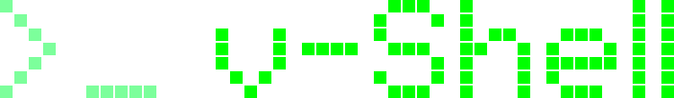

<p align="center"></p>

# v-Shell security core

This is the security-relevant code of [v-Shell](https://v-shell.cerebro.host), an SSH terminal for
iPhone and iPad. It is published so anyone can read it, run its tests and look for
vulnerabilities. It is **source-available, not open source**: see [License](#license).

## What is here
- `Packages/VShellCore/Sources/VShellSSH`: the SSH client. Host-key checks (no silent trust
  on first use), the second-address rule (a Tailscale address only accepts the key already
  known for that computer), sign-in order (nothing is sent before the server's identity is
  checked), refused server-opened channels, output limits.
- `Packages/VShellCore/Sources/VShellCore`: keys (Ed25519 made on the device, Keychain,
  this device only), key import (Ed25519 and ECDSA only), link, QR and `~/.ssh/config`
  parsing, iCloud sync sanitising (no startup commands, no hidden keypresses, no auto-run),
  the commands v-Shell runs on your computer (single-quoted, tested), metric command safety,
  support report redaction.
- `Packages/swift-nio-ssh`: Apple's swift-nio-ssh 0.15.0 (Apache 2.0) with one patch for
  keyboard-interactive sign-in. Every change is listed in `VSHELL-PATCHES.md`.
- `server/setup.sh`: the optional setup script on v-shell.cerebro.host. Its SHA256 is in
  `server/setup.sh.sha256`; it must match the one on the website.
- Tests, including live tests against a real OpenSSH server in Docker.

## What is not here
The app's screens (SwiftUI) are not published. Some protections live there and are
described on [v-shell.cerebro.host/security](https://v-shell.cerebro.host/security): the
"Is this your computer?" prompt, the Face ID lock, secure typing at password prompts, and
how links, QR codes and the clipboard are shown before anything connects.

## Run the tests (Mac with Xcode, Docker for the live tests)
```
scripts/test-sshd.sh
VSHELL_SSHD=1 swift test --package-path Packages/VShellCore
```
Without Docker, `swift test --package-path Packages/VShellCore` runs everything except the
live SSH tests.

## Limits
- Nobody can prove that the App Store app was built from this code: iOS builds are not
  reproducible. Each release here is tagged with the App Store build number it matches.
- This code has had AI-assisted security reviews and automated tests. It has not had a
  paid third-party penetration test yet.

## Report a problem
See [SECURITY.md](SECURITY.md).

## License
- Our code: [PolyForm Strict 1.0.0](LICENSE.md), plus the extra permission for security
  research in [SECURITY.md](SECURITY.md). You may read, run and test it. You may not
  redistribute it or ship it in another product.
- `Packages/swift-nio-ssh`: Apache 2.0 (its own `LICENSE.txt`), including our patch.
- Required Notice: Copyright 2026 Cerebro AI (https://v-shell.cerebro.host). v-Shell is a trademark of Cerebro AI.
